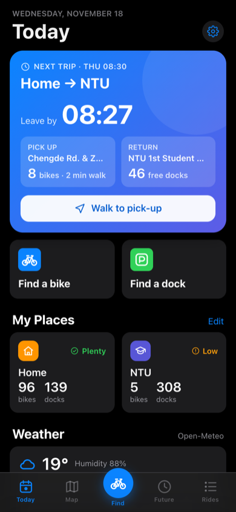
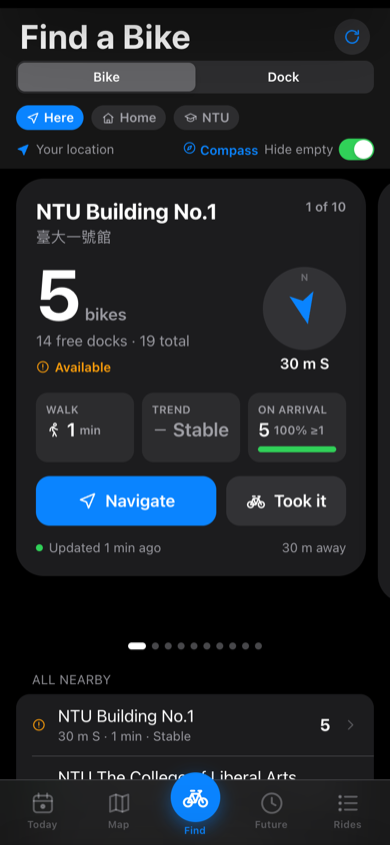
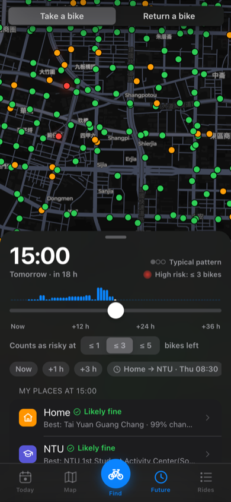
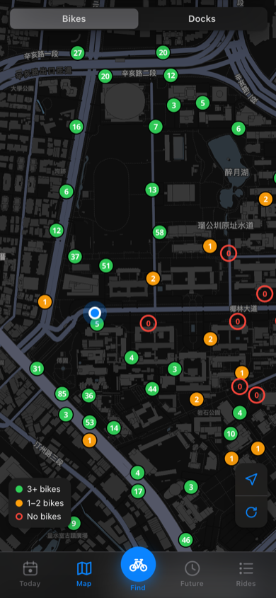

# Bike · YouBike Optimizer Taipei

A personal companion for Taipei's **YouBike 2.0** bike share: find a bike or a free dock in one tap,
and see what your stations will look like over the next **36 hours**.
Regular bikes only; e-bikes (2.0E) are ignored by design.

<p>
  
  
  
  
</p>

> Not affiliated with YouBike Co., Ltd. or the Taipei City Government. Uses their public open data.

## Features

**Phone app** (installable web app, works offline with the last known data)

- **Today**: your next usual trip with a *leave by* time, the best pick-up and return station,
  live status of your saved places, rain warnings and an hourly forecast.
- **Find a Bike / Find a Dock**: nearest stations as swipeable cards with live counts, walking
  distance and time, a direction arrow that turns with the compass, the 20-minute trend, the
  expected count when you arrive, and one-tap walking directions in Google Maps or Apple Maps.
  If your chosen station empties while you walk, the phone vibrates and suggests the next one.
- **Future**: drag a slider across the next 36 hours. The map shades areas where you'll probably
  find **≤ 3 bikes** (or ≤ 3 free docks). The threshold can be 1, 3 or 5. Trip shortcuts show the
  pick-up and return outlook for your usual commute.
- **Map**: every station, colored by bikes or docks, with a 24-hour forecast per station.
- **Rides**: log rides with *Took it* / *Returned* (cost from the fare table), weekly stats.


## Run it

There are three ways. The server adds 24-hour history, heatmaps (Insights), CWA weather and events.

### 1. Phone app only, no server (free static hosting)

The app runs entirely in the browser: it reads the live YouBike feed and the Open-Meteo forecast
directly, and keeps your places, trips and rides in the phone's local storage.

```bash
python3 -m venv .venv && .venv/bin/pip install -e .
.venv/bin/python scripts/deploy_static.py --build      # → deploy/static-build/
```

Serve `deploy/static-build/` from the **root** of any static host (the app uses absolute paths
such as `/app/…`). `scripts/deploy_static.py` without `--build` publishes it as a free static
[Hugging Face Space](https://huggingface.co/docs/hub/spaces-sdks-static) (`huggingface-cli login`
first) and prints a private install link. Your places travel only in that link's `#setup=…`
fragment, never in the published files. On the iPhone, open the link in Safari, then Share → Add to
Home Screen. GPS and the compass need HTTPS, which these hosts provide.

Not available in this mode: 24-hour history, heatmaps, measured CWA weather, events.

### 2. With a server on your computer

```bash
python3 -m venv .venv && .venv/bin/pip install -e .
cp .env.example .env              # optional: CWA_API_KEY (free, opendata.cwa.gov.tw)
.venv/bin/python -m ubike serve   # prints the phone link incl. your access key
```

One process runs everything: the API, the phone app (`/app`), a
poller that stores the live feed every 60 s, and hourly/daily jobs for weather, calendar, events and
elevation. An access key (`UBIKE_KEY`, generated into `.env`) protects every API call.

- Keep it running on macOS: `scripts/install_launchd.sh`
- Use it from the phone over HTTPS: `scripts/phone.sh` (a free Cloudflare quick tunnel; the URL
  changes on each start)
- Without the server: `ubike daily`, `ubike hourly`, `ubike status`,
  `ubike history --start 2023-01-01 --end 2023-12-31`

### 3. With a server on a free cloud VM

Oracle Cloud *Always Free* or Google Cloud's free *e2-micro* (both ask for a card to verify
identity). Create an Ubuntu 24.04 VM, allow TCP 80/443, then from your computer:

```bash
deploy/vm/push.sh ubuntu@<vm-ip>
```

It copies the code, your `.env` and (the first time) your local database, installs Python and
Caddy, runs the app as a systemd service and serves it at `https://<ip-with-dashes>.sslip.io`
with a free Let's Encrypt certificate.

## Forecast model

The Future tab combines several data sources:

1. **Demand.** Departures and arrivals per station × workday/day-off × hour, from the city's
   monthly trip records (8 million trips in May 2026). Built by `ubike/forecast.py` into
   `web/app/model.json` (~500 KB).
2. **Rain.** Demand drops to ×0.94 in light rain, ×0.26 at 1–4 mm/h and ×0.15 in heavy rain.
   These factors were fitted by joining the trips with ERA5 hourly precipitation and are applied to
   the live Open-Meteo forecast.
3. **Calendar.** Public holidays and make-up workdays from the government calendar.
4. **Simulation, on the phone** (`web/app/forecast.js`). Each station is a probability distribution
   over 0…capacity. Every 30 minutes it applies Poisson departures and arrivals that stop at
   empty/full, plus a weak pull toward the station's current level as a stand-in for rebalancing
   trucks. The output is the chance of finding ≤ k bikes or docks at any time in the next 36 h.

**Validation.**

- Hourly demand on held-out days: 36% more accurate than a flat daily baseline.
- One hour ahead: a ~40% lower Brier score than "nothing changes" (bikes). This test covers only
  one evening.
- Known weakness: the trip records can't see demand at stations that are already empty, so
  horizons beyond ~12 h under-predict chronically empty stations. The app labels confidence
  (high ≤ 3 h, medium ≤ 12 h, "typical pattern" beyond).

Collecting a few weeks of snapshots with the server will allow a proper refit.

Rebuild with a newer month (the list of files is in
[`YouBikeHis.csv`](https://tcgbusfs.blob.core.windows.net/dotapp/youbike_second_ticket_opendata/YouBikeHis.csv)):

```bash
.venv/bin/python -m ubike.forecast data/trips_raw/<month>/trips_<yyyymm>.csv
```

## Data sources

| Data | Source | Key |
|---|---|---|
| Live availability (every 60 s) | [Taipei YouBike 2.0 feed](https://tcgbusfs.blob.core.windows.net/dotapp/youbike/v2/youbike_immediate.json) (data.taipei) | no |
| Trip records (forecast training) | Taipei YouBike 2.0 ticket data, monthly | no |
| Forecast, nowcast, weather history | [Open-Meteo](https://open-meteo.com) (ERA5 archive) | no |
| Station observations, rain gauges, warnings | [Central Weather Administration](https://opendata.cwa.gov.tw) | free key |
| Holidays, make-up workdays | Government calendar via [TaiwanCalendar](https://github.com/ruyut/TaiwanCalendar) | no |
| Concerts, theatre, exhibitions | [Ministry of Culture open data](https://cloud.culture.tw) | no |
| Elevation | [OpenTopoData](https://www.opentopodata.org) SRTM + ASTER 30 m, Open-Meteo Copernicus 90 m | no |
| Map tiles | © [OpenStreetMap](https://www.openstreetmap.org/copyright) contributors, © [CARTO](https://carto.com/attributions) | no |

Taiwanese government data is used under the
[Open Government Data License, version 1.0](https://data.gov.tw/license); Open-Meteo data under
CC BY 4.0.

## Project layout

```
ubike/                 Python package
  server.py            FastAPI app: API, static files, poller + context jobs, access key
  live.py              60 s poller, in-memory state, trends, arrival prediction
  personal.py          places, trips, rides, Today summary, heatmaps
  forecast.py          builds the demand model from trip records
  context/             weather (Open-Meteo, CWA), events + calendar, elevation
  db.py                DuckDB schema (all timestamps are Asia/Taipei local time)
  cloud.py             optional backup/restore to a private Hugging Face dataset
web/app/               phone app (vanilla JS, no build step)
  app.js, app.css      screens and Apple-style UI
  forecast.js          36 h availability forecast (runs on the phone)
  local-api.js         serverless replacement for the API (static build)
web/shared/            design tokens, icons, charts
config/                weather points, venue capacities, default places, fares
scripts/               static deploy, launchd service, phone tunnel
deploy/                Hugging Face Docker image, free-VM setup
```

## Privacy

- **Nothing personal in the repository.** Places, rides, settings, keys and collected data live in
  `data/`, `.env` or the phone's local storage, and all of those are git-ignored.
- **Location stays on the device.** It is used in the browser to sort stations and point the
  direction arrows. The live feed is downloaded for the whole city, so it reveals nothing about you.
  The weather request sends a position rounded to about 2 km to Open-Meteo, and map tiles are
  loaded for the area you are viewing.
- **The server is locked.** It requires the access key for every API call.

## Status

A working prototype for one rider. Not built yet: notifications (LINE, web push, morning briefing),
learned prediction models trained on collected snapshots, origin–destination flow maps, and the
incentive simulator. The original [requirements](ubike_optimizer_requirements.md) list the full
plan.

## License

Code: [MIT](LICENSE). Data belongs to the respective providers listed above.
